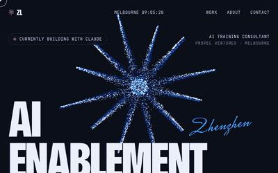

# Zhenzhen Liu

**AI Training Consultant** · Propel Ventures

Melbourne, Australia

▶ <a href="https://zhenzhenliu-propel.github.io/zhenzhenliu-propel/motion/">Open the live version</a>

---

### About
I work on client-facing AI enablement engagements at [Propel Ventures](https://www.propelventures.ai/) - running discovery, designing training, and turning it into structured proposals and deliverables.

### Focus
- 🧠 AI enablement & capability uplift
- 📋 Discovery → structured proposals & deliverables
- 🤝 Client-facing engagement work

### Connect

🧭 Propel Ventures · Navy 00164C / Hero Blue 73DEFF

